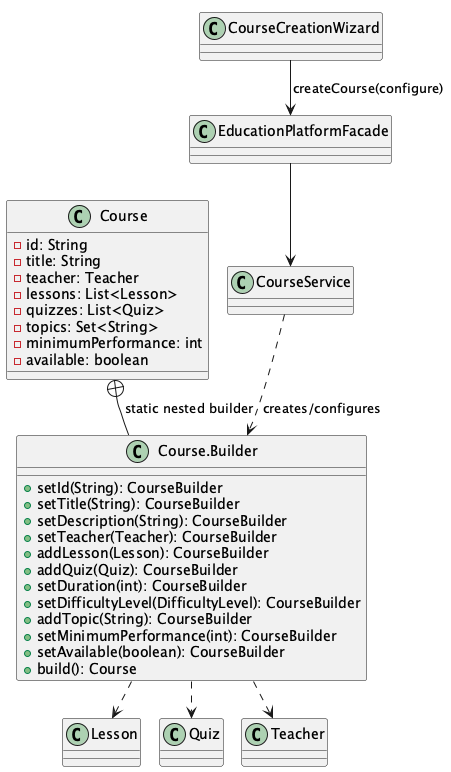
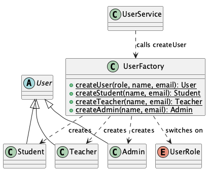
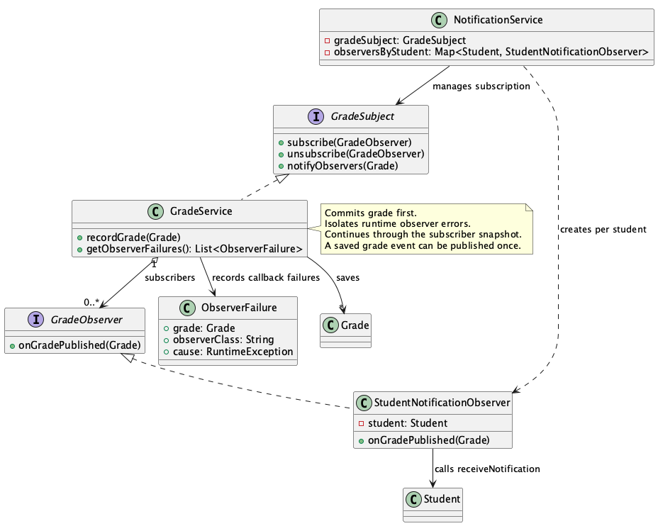
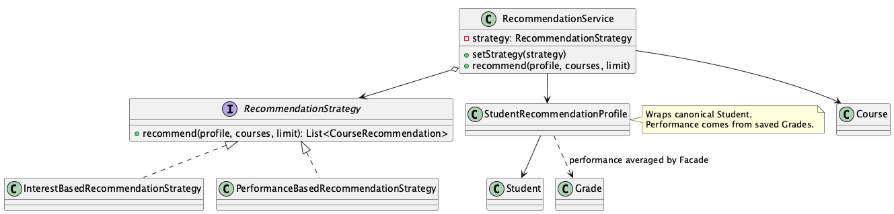
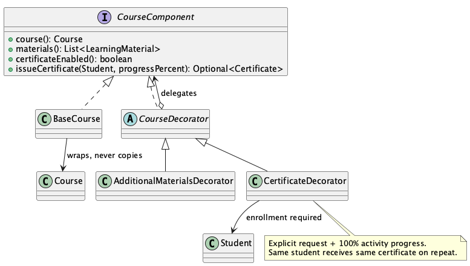
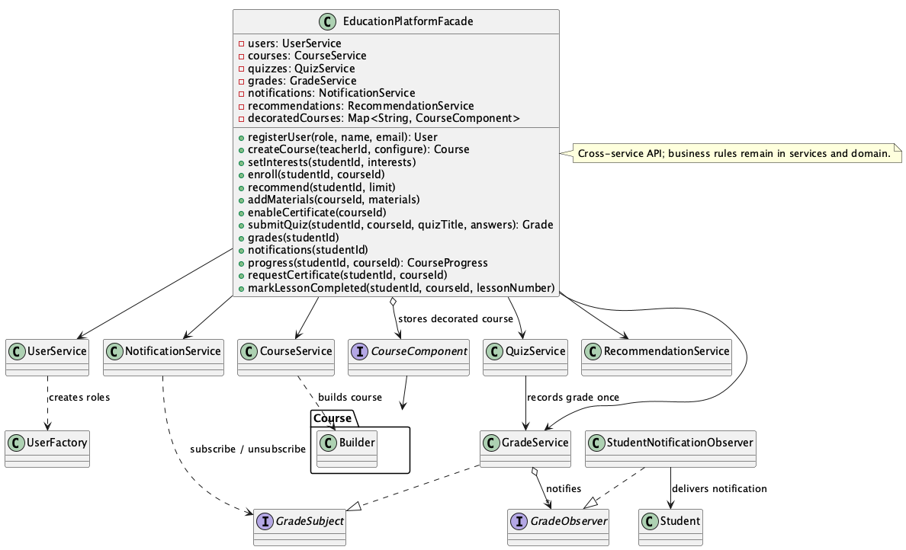
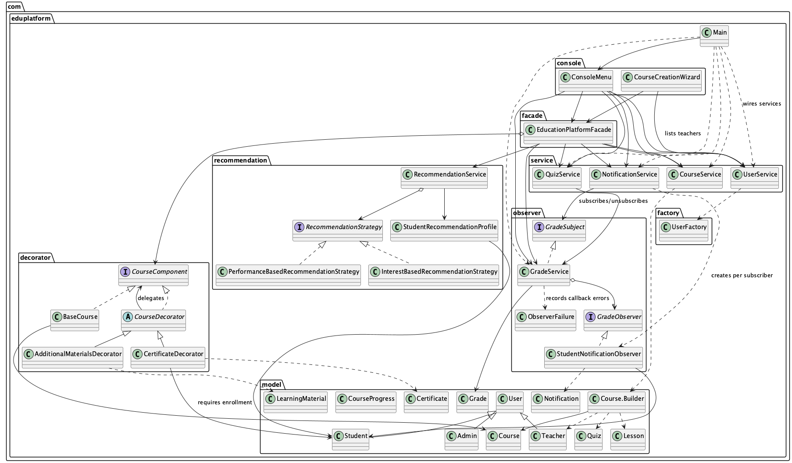
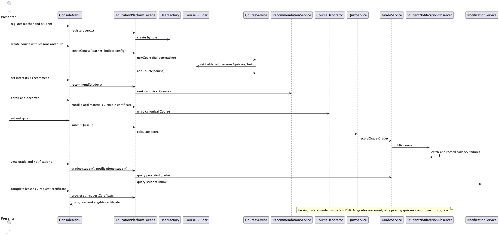

# Online Education Platform

**Final Project Report**

**Course:** Software Design Patterns
**Group:** SE-2506
**Instructor:** Ospanov Almas
**Authors:** Nurasyl Raiskaliev and Kakhar Nassyrkhan

<!-- PAGEBREAK -->

## 2. Introduction

The goal of this project is to build a simple platform for online learning and to show how design patterns can solve common software problems. We chose online education because students, teachers, courses, quizzes, and progress are familiar parts of university learning. These parts also have different responsibilities and need to work together.

Design patterns give developers tested ways to organize object creation, behavior, and communication. They can make code easier to extend and understand. This project demonstrates six patterns in one Java application: Builder, Factory, Observer, Strategy, Decorator, and Facade.

## 3. Project Overview

The application is a Java 21 console platform. Students can enroll in courses, complete lessons and quizzes, review grades and notifications, set interests, receive recommendations, and request certificates. Teachers create courses with lessons and quizzes. Admin users have a platform overview. The project uses one production `Course`, `Student`, and `Grade` model in `com.eduplatform.model`.

Each course has a teacher, description, lessons, quizzes, duration, difficulty, topics, an availability flag, and a minimum performance requirement for recommendations. A quiz attempt creates a grade. A grade event is published to subscribed observers, and the correct student receives a notification. The two recommendation strategies use student interests and saved grades. Course decorators add learning materials and optional certificate support without changing the original course. The Facade coordinates these services for application workflows.

Users start at `com.eduplatform.Main` and work through one console menu. They can register users, create and enroll in courses, take quizzes, view results, request recommendations, and track progress. The menu's **Load Demo Data** option quickly prepares sample users and a course for a presentation.

Progress counts completed lesson positions and passed quizzes. A quiz passes when its rounded displayed score is at least 70%. A failed attempt is saved and notifies subscribers, but it does not count as quiz completion. Lesson positions distinguish lessons that have the same title. A certificate is available only after explicit request when the student is enrolled, certificate support is enabled, and progress is 100%. Repeated requests return the same issued certificate.

## 4. Design Patterns Used

### 4.1 Builder

- **Pattern type:** Creational.
- **Intent:** Build a complex object step by step and validate it before it is returned.
- **Why this project uses it:** A course has required data and many optional parts. The Builder keeps this setup readable and checks the course rules in one place.
- **Main classes:** `Course`, `Course.Builder`, `CourseCreationWizard`, and `CourseService`.
- **UML roles:** `Course.Builder` is the Builder; `Course` is the Product; `CourseCreationWizard` and `CourseService` are clients.
- **How it works:** The client sets the teacher, duration, difficulty, lessons, quizzes, and recommendation data. `build()` validates required fields and creates an immutable course.
- **Advantages:** Method chaining is clear; course validation is centralized; new course fields can be added without many constructors.
- **Limitations:** The Builder must grow when the course model gains new fields.

### 4.2 Factory

- **Pattern type:** Creational.
- **Intent:** Create the correct user subtype from a role request.
- **Why this project uses it:** Registration needs to create Student, Teacher, and Admin objects with a shared validation path.
- **Main classes:** `UserFactory`, `UserService`, `User`, `UserRole`, `Student`, `Teacher`, and `Admin`.
- **UML roles:** `UserFactory` is the Factory; `User` is the product base type; the three role classes are concrete products; `UserService` is the client.
- **How it works:** The factory checks the role, normalizes name and email, assigns an ID, and returns the matching subtype. The user service validates registration data before storing the object.
- **Advantages:** Callers do not construct role classes directly; role creation follows one rule set.
- **Limitations:** Adding a new role requires a new subtype and a new factory case.

### 4.3 Observer

- **Pattern type:** Behavioral.
- **Intent:** Notify interested objects when a grade event occurs.
- **Why this project uses it:** Quiz grading should be able to notify students without implementing notification delivery itself.
- **Main classes:** `GradeSubject`, `GradeObserver`, `GradeService`, `NotificationService`, `StudentNotificationObserver`, and `ObserverFailure`.
- **UML roles:** `GradeService` is the Subject; `GradeObserver` is the Observer interface; `StudentNotificationObserver` is a Concrete Observer; `NotificationService` manages subscriptions.
- **How it works:** `GradeService` stores a grade and publishes that event once. A student observer checks the recipient and adds a notification to that student's inbox. Subscribers can be added and removed. A runtime exception from one observer is recorded, and later observers still receive the event.
- **Advantages:** Grade storage is separate from notification delivery; multiple observers can react to a grade.
- **Limitations:** An observer failure is recorded for later review, but failed notification delivery is not retried automatically.

### 4.4 Strategy

- **Pattern type:** Behavioral.
- **Intent:** Select and change an algorithm without changing the service that calls it.
- **Why this project uses it:** Students can receive course recommendations using different criteria.
- **Main classes:** `RecommendationStrategy`, `InterestBasedRecommendationStrategy`, `PerformanceBasedRecommendationStrategy`, `RecommendationService`, and `StudentRecommendationProfile`.
- **UML roles:** `RecommendationService` is the Context; `RecommendationStrategy` is the Strategy interface; the two recommendation classes are Concrete Strategies.
- **How it works:** The interest strategy compares the student's interests with course topics. The performance strategy compares the real average of saved grades with a course's minimum performance requirement. The active strategy can change at runtime. A student with no grades has a documented starting performance of 0%.
- **Advantages:** Recommendation algorithms are separate and can be replaced at runtime.
- **Limitations:** Each new algorithm needs its own class and a clear way to select it.

### 4.5 Decorator

- **Pattern type:** Structural.
- **Intent:** Add optional behavior around an object while preserving its original interface.
- **Why this project uses it:** Materials and certificate support are optional course features and should not mutate the canonical course.
- **Main classes:** `CourseComponent`, `BaseCourse`, `CourseDecorator`, `AdditionalMaterialsDecorator`, and `CertificateDecorator`.
- **UML roles:** `CourseComponent` is the Component; `BaseCourse` is the Concrete Component; `CourseDecorator` is the abstract Decorator; the materials and certificate classes are Concrete Decorators.
- **How it works:** `BaseCourse` wraps the canonical `Course`. Decorators delegate to their wrapped component and add materials or certificate behavior. Decorators can be nested. Certificate creation requires an explicit request, enrollment, and 100% progress.
- **Advantages:** Optional features can be combined while preserving the course, lessons, quizzes, and teacher.
- **Limitations:** Several nested decorators can make the runtime object harder to inspect.

### 4.6 Facade

- **Pattern type:** Structural.
- **Intent:** Provide one simple API over several services and subsystems.
- **Why this project uses it:** A console workflow needs to coordinate registration, course creation, recommendations, grading, notifications, and progress.
- **Main classes:** `EducationPlatformFacade`, `UserService`, `CourseService`, `QuizService`, `GradeService`, `NotificationService`, `RecommendationService`, and `CourseComponent`.
- **UML roles:** `EducationPlatformFacade` is the Facade; the service classes and decorated course components are the subsystems; `ConsoleMenu` is a client.
- **How it works:** The Facade validates cross-service inputs and delegates the business operation to the service or domain class that owns the rule. For example, it finds a course quiz and delegates an attempt to `QuizService`.
- **Advantages:** The application has one entry point for coordinated workflows, and service logic remains in the appropriate services.
- **Limitations:** The Facade must remain a delegator; otherwise it can grow into a hard-to-maintain God Class.

### Team responsibilities

- **Nurasyl Raiskaliev:** Builder, Factory, Observer.
- **Kakhar Nassyrkhan:** Strategy, Decorator, Facade.

## 5. UML Diagrams

Each diagram below is rendered from the matching PlantUML source in `docs/uml/`. The `.puml` files are included in the repository so the images can be regenerated.

### Builder UML



`Course.Builder` creates the immutable `Course`. The wizard passes its configuration through the Facade to the course service and Builder.

### Factory UML



`UserService` calls the factory, which selects Student, Teacher, or Admin using `UserRole`.

### Observer UML



`GradeService` publishes saved grades to subscribers. The notification service creates a student observer for each subscription and can remove it later.

### Strategy UML



`RecommendationService` holds the active strategy. The profile contains the canonical Student and performance derived from saved grades.

### Decorator UML



The base component preserves the canonical course. Additional decorators add materials or certificate support and delegate the remaining behavior.

### Facade UML



The Facade coordinates the actual service dependencies and decorated course component. Quiz grading reaches the Observer subsystem through `GradeService`.

### Overall Architecture UML



This diagram shows the packages, the canonical model, and the dependencies between the console, Facade, services, and six patterns.

### End-to-End Sequence UML



The sequence follows user registration and course creation through recommendations, enrollment, quiz grading, notifications, progress, and a certificate request.

## 6. Code Explanation

The following short fragments are taken from the production source.

### Builder code

```java
public Course build() {
    List<String> errors = validate();
    if (!errors.isEmpty()) {
        throw new IllegalStateException("Cannot build course: " + String.join("; ", errors));
    }
    return new Course(this);
}
```

The Builder checks course rules before it creates the product. This prevents an invalid course from entering the catalog.

### Factory code

```java
return switch (role) {
    case STUDENT -> new Student(id, normalizedName, normalizedEmail);
    case TEACHER -> new Teacher(id, normalizedName, normalizedEmail);
    case ADMIN -> new Admin(id, normalizedName, normalizedEmail);
};
```

The factory selects a concrete user class from the requested role and returns it through the shared `User` type.

### Observer code

```java
grades.add(grade);
notifyObservers(grade);
```

The grade is committed before observers run. `GradeService` records callback failures and continues with the remaining subscribers.

### Strategy code

```java
public synchronized void setStrategy(RecommendationStrategy strategy) {
    this.strategy = Objects.requireNonNull(strategy, "strategy must not be null");
}
```

The service can replace its recommendation algorithm while the application is running.

### Decorator code

```java
public List<LearningMaterial> materials() {
    List<LearningMaterial> result = new ArrayList<>(super.materials());
    result.addAll(extras);
    return List.copyOf(result);
}
```

The materials decorator adds its own materials to the wrapped component's list and returns an immutable result.

### Facade code

```java
public User registerUser(UserRole role, String name, String email) {
    return users.registerUser(role, name, email);
}
```

The Facade exposes a single application API and delegates registration to `UserService`, which uses the Factory.

## 7. Application Screenshots

**BLOCKED — authentic screenshots are not included.** The available UI session exposed IntelliJ's Run output, but it did not provide a supported way to save an image into the repository. The standalone Terminal app was unavailable to the computer-use session. No screenshots have been generated or substituted. Before final submission, capture the main menu, demo data, recommendation result, quiz grade and notification, and certificate result from a local application run. See `docs/screenshots/README.md`.

## 8. Testing and Verification

- **Maven:** `mvn clean verify` completed successfully on 2026-11-13.
- **JUnit:** 73 tests ran; 73 passed, 0 failed, 0 errors, and 0 skipped. The suite includes the original tests from both feature implementations, integration tests, and a scripted console workflow.
- **Runtime:** `mvn package` succeeded. The executable JAR `target/eduplatform-1.0-SNAPSHOT.jar` was run with scripted input to load demo data and exit; it displayed the unified menu and returned exit code 0.
- **Java:** The Maven compiler targets Java 21 with `maven.compiler.release=21`. The local runtime used for verification was OpenJDK 26.0.2.1; a local Java 21 runtime run was not performed.
- **CI:** `.github/workflows/maven.yml` configures Temurin Java 21 and `mvn clean verify`. A successful hosted GitHub Actions run was not verified for this report.
- **UML and PDF:** PlantUML rendered the diagrams. All 16 PDF pages were rendered and visually checked with macOS Quick Look.

## 9. Problems We Faced and Solutions

- **Two feature branches had separate implementations →** We integrated both histories on `integration/final-project` and kept the teammate's Builder, Factory, and Observer application as the production base.
- **Course, Student, and Grade models had different APIs →** The integrated workflow uses the canonical `com.eduplatform.model` classes. The other implementation's independent contract tests remain under test sources.
- **Lessons with the same title could share a progress mark →** Student progress now stores lesson positions in the course, not lesson titles.
- **Any quiz result could previously mark a quiz complete →** The project now defines a 70% rounded-score pass rule. Failed attempts remain in the grade history but do not count toward completion.
- **Invalid interests could erase the previous interests →** The Student validates a temporary normalized set and swaps it into place only after full validation.
- **An observer exception could interrupt quiz completion and later notifications →** GradeService commits the grade, records runtime callback failures, continues notifying later observers, and rejects duplicate publication of the same grade event.
- **Old UML links and report exports did not show the integrated relationships →** The PlantUML sources were checked against actual dependencies, rendered, and embedded with explanations in the generated PDF.

## 10. Conclusion

The project integrates six design patterns into one working online education platform. The same users and courses flow through course creation, recommendations, enrollment, quiz grading, notifications, progress tracking, and certificate requests. The test suite verifies these workflows, and the console menu provides a practical way to demonstrate them.

The report and UML diagrams describe the current code. The report still needs authentic application screenshots before it is ready for final academic submission.

## 11. Further Work

Future work can add a graphical or web interface, persistent database storage, richer analytics, more advanced recommendation algorithms, expanded certificate management, and improvements for concurrent users and larger course catalogs.
